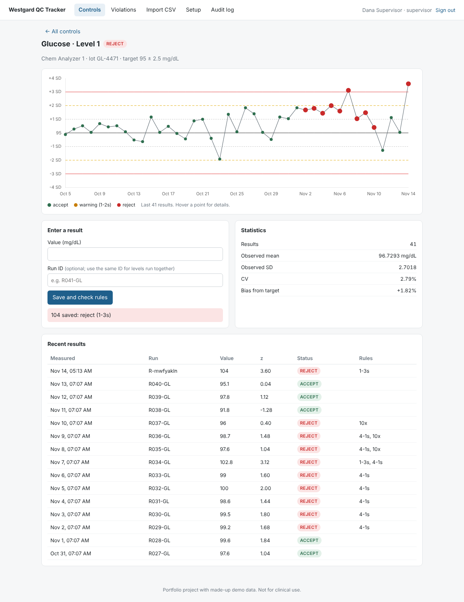
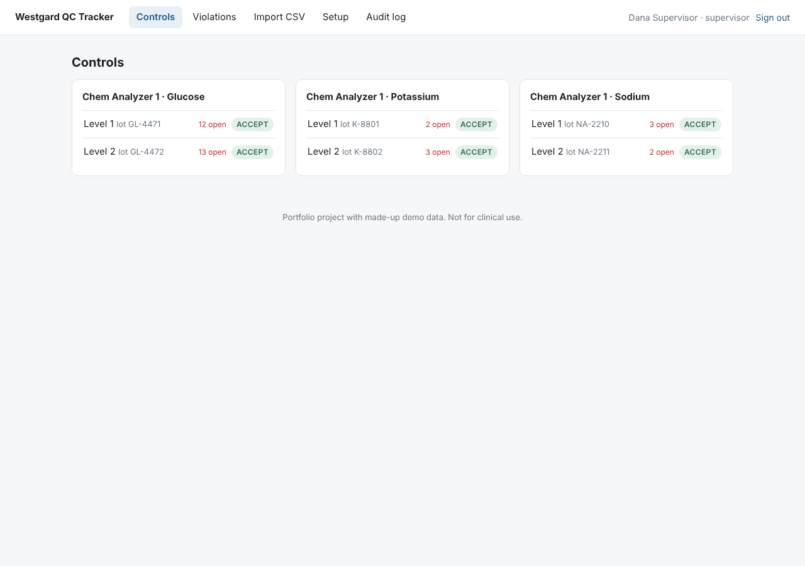
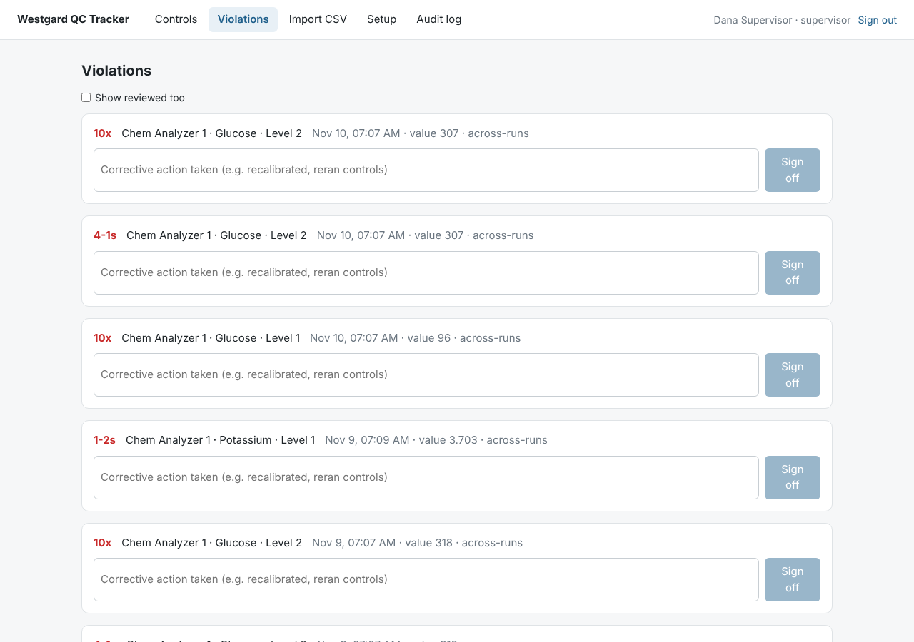

# Westgard QC Tracker

A full-stack web app for clinical laboratory quality control. Techs log daily control results, the app checks each one against the Westgard multirules, and supervisors review and sign off on violations. Every result is plotted on a Levey-Jennings chart.

**Live demo:** add your link here after deploying (sign in as `supervisor@demo.lab` or `tech@demo.lab`, password `demo1234`)



> Portfolio project with made-up demo data. It is not validated for clinical use.

## Why I built it

Labs run control samples every day to make sure their instruments are measuring correctly. The Westgard rules are how a lab decides whether a run is trustworthy, and in many labs that check still happens by eye on a printed chart. I studied clinical chemistry in a Medical Laboratory Science program, and this app automates that check.

## Features

- **Westgard rule engine** covering 1-2s (warning), 1-3s, 2-2s, R-4s, 4-1s and 10x, both across runs for one control and across control levels within a single run
- **Levey-Jennings chart** for each control, with lines at the mean and ±1, 2 and 3 SD, and every result colored by status
- **Violation log** where corrective actions are recorded. Only a supervisor can sign off a rejected run.
- **Logins with two roles:** tech and supervisor
- **CSV import** for a batch of results, processed in measurement order so the rules see the correct history
- **Statistics per control:** observed mean, SD, CV%, and bias from the target
- **Audit log** of every result entered, control created, and violation reviewed

## Tech stack

| Part | Tool |
|---|---|
| Backend API | Python, FastAPI |
| Database | PostgreSQL in production, SQLite for local runs and tests, through SQLAlchemy 2.0 |
| Auth | Salted PBKDF2 password hashes and JWT tokens |
| Frontend | React with Vite, Chart.js |
| Tests | pytest: 35 tests covering every rule and every API route |
| CI | GitHub Actions runs the tests and the frontend build on every push |
| Deployment | Docker, with a multi-stage build that bundles the frontend into the API image |

## How it works

```
Browser (React)  ──HTTP/JSON──▶  FastAPI  ──SQLAlchemy──▶  PostgreSQL
                                    │
                                    └── westgard.py (pure Python rule engine)
```

1. A tech enters a value, or several levels from the same run.
2. `qc.record_run()` saves the results, then loads the last 9 results for each control. Ten is the longest rule's window, and it's ordered by **measurement time, not entry time**, so a late-entered result is judged against the right history.
3. Each value becomes a z-score, `(value − target mean) ÷ target SD`, and goes to `westgard.check_across_runs()`.
4. Results from other levels of the same analyte in the same run go to `westgard.check_within_run()` for R-4s and 2-2s across levels.
5. Any rule that fires becomes a violation, the result's status is set to accept, warning, or reject, and an audit entry is written.

The rule engine has no web or database code, which keeps it easy to test: each rule has a test that should trigger it and a near miss that shouldn't.

## Screenshots

| Dashboard | Violation review |
|---|---|
|  |  |

## Run it

**With Docker** (app and PostgreSQL):

```
docker compose up --build
```

Open http://localhost:8000. Demo data loads on the first start.

**Without Docker:**

```
cd backend
pip install -r requirements-dev.txt
python -m app.seed               # demo users, controls, and 40 days of results
uvicorn app.main:app --reload    # API on http://localhost:8000, docs at /docs

cd ../frontend
npm install
npm run dev                      # app on http://localhost:5173
```

**Tests:**

```
cd backend && pytest
```

## Deploy

The repository includes a `Dockerfile` that any Docker host can run (Render, Railway, Fly.io). Set two environment variables:

- `DATABASE_URL`: your PostgreSQL connection string
- `SECRET_KEY`: a long random string, used to sign login tokens

## Project layout

```
backend/
  app/westgard.py   rule engine (pure Python)
  app/qc.py         saving results and applying the rules
  app/main.py       API routes
  app/models.py     database tables
  app/auth.py       password hashing, tokens, roles
  app/stats.py      mean, SD, CV%, bias
  app/seed.py       demo data with built-in problems for each rule to catch
  tests/            pytest suite
frontend/src/
  main.jsx          app shell and navigation
  pages.jsx         dashboard, control detail, violations, import, setup, audit
  LeveyJennings.jsx the chart
  api.js            fetch wrapper with the login token
```
